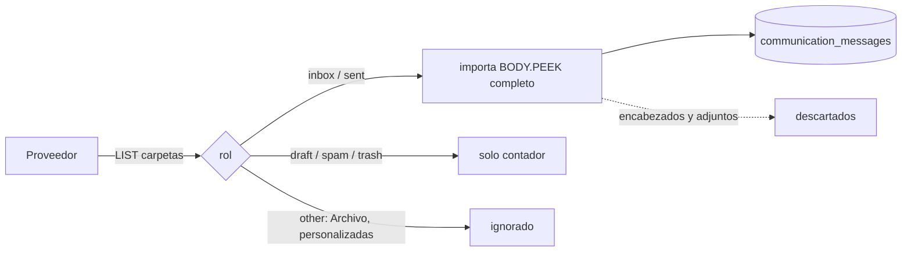

# Auditoría maestra de Donexto: motor de descubrimiento, análisis y gestión de compromisos

**Fecha:** 30 oct 2026, hora de Ciudad de México (UTC-6).
**Código revisado:** `origin/main`.
**Autor:** Grok, para revisión independiente de ASTRA IA.
**Modo:** SOLO LECTURA.
- En producción solo se ejecutaron SELECT.
- No se modificó código, datos ni configuración.
- No hubo descargas, importaciones ni acceso a buzones.
- No se crearon migraciones ni índices.
- No hubo reinicio, despliegue ni fusión.
- BRAIN_V1 y push siguen apagados.
- No se hicieron llamadas de pago: ni a la API de xAI ni a APIs de embeddings.

**Amplía, sin repetir:**
- `informe-tecnico.md` (misma carpeta, secciones A–N).
- `docs/auditorias/eval01/diagnostico-casos.md`, en la rama `docs/eval01-diagnostico-casos`.
- CONC-01: issue #207, corrección en el PR borrador #214.

**Convenciones:**
- Rutas relativas a `backend/app/services/` salvo que se indique otra.
- **[COMPROBADO]** = demostrado con código o datos. **[ESTIMADO]** = cálculo con supuestos. **[PROPUESTA]** = diseño no implementado.

---

## A. Diagnóstico del motor actual

Detalle en `informe-tecnico.md` §A y §C.

| Componente | Existe | Se ejecuta en producción | Tipo | Evidencia |
|---|---|---|---|---|
| `safe_case_classifier.classify_pending_messages` | sí | **sí** | reglas deterministas (palabras clave, 1,600 caracteres) | `safe_case_classifier.py:475,317,327` |
| `case_engine.process_message` | sí | sí, solo si `actionable` | determinista | `case_engine.py:733`; `safe_case_classifier.py:589` |
| `brain_v1/*` (unas 2,900 líneas) | sí | **no** (bandera apagada; 0 filas con `brain_signals`) | reglas, con respaldo LLM opcional | `brain_v1/__init__.py:13`; `llm_fallback.py:40` |
| `ai_analyzer.py` | sí | **no** (mock, solo endpoint manual; `ai_analysis` = 0 filas) | **simulación** | `ai_analyzer.py:905-918`; `api/ai.py:40` |
| Adjuntos | solo se marca que existen | no se procesan (tabla `attachments` = 0 filas) | incompleto | `yahoo_imap.py:432-434` |
| Motor de notificaciones push | sí | apagado por decisión (0 mensajes con `push_notified_at`) | – | SQL §I |
| Dashboard | sí | sí; **reclasifica en el navegador** (16 áreas) | determinista en el frontend | `frontend/lib/nucleo/lifeAreas.ts:9-27,247` |

**Qué ignora** (puntos 8 y 9 del brief): HTML, cuerpo más allá de 1,600 caracteres, adjuntos, encabezados (List-Unsubscribe, Authentication-Results), zona horaria original y carpetas distintas de recibidos y enviados.

**Dictamen A:** la clasificación es 100% determinista y la IA no participa en ninguna decisión. **[COMPROBADO]**

## B. Causas de los fallos de detección

Detalle con archivo y línea en `informe-tecnico.md` §H (H-01…H-16). En resumen:

1. **Diseño "1 mensaje → ¿caso sí o no?"**: ninguna categoría `notice` abre caso (268/500). Ver `safe_case_classifier.py:309-314,375-381,386-387`.
2. **Dependencia del remitente y el asunto.** `automated` se decide antes que el contenido (`:390`) y `review` es el destino por omisión (`:437`).
3. **Sin comprensión del cuerpo ni de compromisos implícitos.** Solo detecta frases conversacionales fijas (`:152-193`).
4. **Sin extracción de fechas ni importes.** `due_at` y `event_at` nunca se llenan (`case_engine.py:816-858`).
5. **Sin agregación de repeticiones.** bazdigital.com suma 168 de 550 mensajes y hay 19 alertas de Google.
6. **Hilos rotos en IMAP** (H-08): ver §H.
7. **Correo enviado ausente en EVAL-01**: ver §F.
8. **Responsables:** `requester_email` = remitente del primer mensaje entrante (`case_engine.py:807-811`). No existe un modelo de "quién debe actuar".
9. **Casos ocultos:** 0. **[COMPROBADO]**

Agregar más reglas no corrige las causas 1, 4, 5, 6 ni 7. Son defectos de **modelo y de datos**, no de vocabulario.

## C. Matriz de campos por proveedor

La matriz de campos (identificadores, direcciones, fechas, encabezados, contenido, adjuntos y metadatos) está en `informe-tecnico.md` §B. Aquí se agregan las columnas pedidas en el brief:
- **B** = solicitado
- **C** = recuperado
- **G** = perdido o descartado

| Proveedor | Solicitado (B) | Recuperado (C) | Perdido / descartado (G) |
|---|---|---|---|
| Gmail API | `messages.get format=full` (`gmail_full_sync.py:187`) | todos los encabezados, cuerpo y labelIds | encabezados no guardados; adjuntos (solo `has_attachments`); internalDate solo como respaldo (`gmail_sync.py:219`) |
| Gmail IMAP (`gmail_imap`, el que existe en producción) | `BODY.PEEK[]` | RFC822 completo | igual que Yahoo |
| MS Graph | `$select` limitado (`microsoft_import.py:37-41`) | sin `internetMessageHeaders`, `categories`, `importance` ni `flag` | In-Reply-To/References = vacío (`:511-512`); adjuntos |
| Yahoo IMAP | `FLAGS BODY.PEEK[]` (`imap_provider.py:58`) | RFC822 completo | encabezados, adjuntos (`yahoo_imap.py:432`), zona horaria (`yahoo_import.py:614-624`), INTERNALDATE |
| iCloud IMAP | mismo código que Yahoo (`yahoo_import.py:62-87`) | igual | igual. **Sin datos en producción; solo se verificó el código** |

## D. Matriz de carpetas examinadas (prioritaria)

Código **[COMPROBADO]**:

| Carpeta | Gmail API / inventario | MS Graph | Yahoo / iCloud / Gmail-IMAP (`yahoo_import.py`) |
|---|---|---|---|
| Recibidos | **importa** (`in:inbox`, `gmail_import_inventory.py:167`) | **importa** `inbox` (`microsoft_import.py:221,328`) | **importa** rol `inbox` (`yahoo_import.py:241,365`) |
| Enviados | **importa** (`in:sent`, `:168`) | **importa** `sentitems` (`:222,329`) | **importa** rol `sent` |
| Archivados / All Mail | Gmail: el filtro base `-in:spam -in:trash -in:drafts` (`:30`) **puede** incluir archivados según la consulta base, pero el desglose solo cuenta inbox y sent. No verificado con datos | **ignora** (solo `inbox` y `sentitems`) | **ignora**: `classify_yahoo_folder` devuelve `other` (`yahoo_imap.py:359-382`), que no está en `roles` (`yahoo_import.py:199`) |
| Carpetas personalizadas | etiquetas de usuario: igual que archivados | **ignora** | **ignora** (`other`) |
| Borradores | **solo se cuentan** (`:188`) | **solo se cuentan** (`:224`) | **solo se cuentan** (`roles` del snapshot, `:235`); no se importan (`:365`) |
| Spam | **solo se cuentan** (`:192`) y se excluyen | **solo se cuentan** (`junkemail`, `:228`) | **solo se cuentan** |
| Papelera | **solo se cuentan** (`:197`) | **solo se cuentan** (`deleteditems`, `:232`) | **solo se cuentan** |
| Categorías Gmail (Promociones, etc.) | como labelIds; se usan en el triage (`safe_case_classifier.py:382-388`) | n/a | n/a |

Datos en producción **[COMPROBADO]** (SQL §anexo, Q-D1):

| provider | carpeta guardada | mensajes |
|---|---|---|
| yahoo (EVAL-01) | INBOX | **550** (ningún SENT ni otra carpeta) |
| gmail_imap (otra cuenta, no analizada por la restricción de hmcelinfo) | INBOX / SENT | 815 / 70 |

- **No existe exploración integral.** Solo se procesan recibidos y enviados; archivados y carpetas personalizadas quedan fuera en IMAP y Graph.
- Borradores, spam y papelera solo se **cuentan**: **no se exploran**.
- **Duplicados entre carpetas:** IMAP deduplica la lista de referencias por carpeta+UID (`dict.fromkeys`, `:365`), pero **no por Message-ID**. El mismo correo en dos carpetas podría importarse dos veces. **Riesgo [PROPUESTA de corrección]:** deduplicar por `internet_message_id` en cada cuenta.
- **Limitaciones por proveedor:**
  - IMAP no tiene hilo nativo.
  - Gmail IMAP expone etiquetas como carpetas, por lo que un mismo correo aparece en varias.
  - Graph tiene `conversationId`, pero Donexto no pide encabezados.

## E. Trazabilidad de extracción y almacenamiento

El diagrama mermaid está en `informe-tecnico.md` §D. Agregado de carpetas:



## F. Auditoría de correos enviados

**EVAL-01 (Yahoo): 0 correos enviados almacenados.** [COMPROBADO] No se pueden evaluar compromisos bidireccionales con estos datos.

Causa probable **[HIPÓTESIS, no comprobada]**:
- La lista de referencias se arma como inbox + sent (`yahoo_import.py:241`).
- El job se canceló en 550/735, así que probablemente nunca llegó a los enviados.
- El job no conserva el desglose por carpeta: sus contadores en `gmail_sync_jobs` no incluyen `sent`.
- Para comprobarlo hace falta el snapshot de la cuenta, que no se guarda.

Tratamiento actual de un mensaje enviado (código):
- Sin caso abierto → `informational`, sin caso (`safe_case_classifier.py:335-338`).
- Con caso abierto → `waiting_external`.
- **Una promesa del usuario ("realizaré la transferencia el viernes") nunca crea un compromiso.**

Diseño **[PROPUESTA]**:
- Analizar los enviados con el mismo extractor.
- `responsible=user` cuando el sujeto gramatical es el remitente propio.
- Estados: `asumido → confirmado → cumplido | incumplido | cancelado`.
- Evidencia de cumplimiento: comprobante entrante con la misma referencia o importe, o una respuesta del destinatario.
- Si vence la fecha comprometida sin evidencia de cumplimiento → `incumplido`, como posible caso, no como hecho.
- **Nunca** marcar como cumplido solo porque hubo una promesa.

## G. Inventario de destinatarios y remitentes (EVAL-01, agregado)

Agregado y enmascarado: solo dominios y conteos. **[COMPROBADO]**

- 102 remitentes distintos en 78 dominios.
- Destinatarios: 541 apariciones de la propia cuenta (yahoo.com) y el resto con baja frecuencia (≤ 8 por dominio). Esto confirma que casi todo el correo es **masivo o transaccional**, no conversacional.

Principales remitentes por dominio (mensajes, direcciones distintas, categoría predominante):

| dominio | msgs | dir. | triage predominante |
|---|---|---|---|
| bazdigital.com | 168 | 1 | notice |
| cc.yahoo.com | 25 | 1 | automated |
| donexto.com | 20 | 2 | automated |
| bbva.mx | 19 | 1 | notice |
| accounts.google.com | 19 | 1 | notice |
| sempraglobal.com.mx | 18 | 2 | informational |
| yahoo.com (notas propias y personas) | 17 | 2 | review |
| mx.email.samsung.com | 17 | 1 | review |
| envio.santander.com.mx | 15 | 2 | notice |
| remify.mx | 15 | 1 | review |
| accountprotection.microsoft.com | 14 | 1 | automated |
| dif.gob.mx (humano) | 11 | 2 | review |
| bbva.com | 11 | 6 | notice |
| cfe.mx | 7 | 3 | review |

**Utilidad [PROPUESTA]:** construir un perfil de remitente (institución, tipo de relación, volumen, si hay intercambio de ida y vuelta) que alimente:
- (1) la prioridad;
- (2) la agregación de avisos repetidos;
- (3) la detección de suplantación: dominio parecido a uno conocido y sin historial.

No se infieren identidades ni relaciones sin evidencia; el campo "organización" queda `desconocido` si no se puede demostrar.

## H. Reconstrucción de conversaciones

Datos de EVAL-01 **[COMPROBADO]**:

| Métrica | Valor |
|---|---|
| Mensajes | 550 |
| Hilos (`thread_id`) | **545** |
| Hilos con más de un mensaje | **5** (máximo 2 mensajes) |
| Con In-Reply-To | 24 |
| In-Reply-To que apunta a un mensaje guardado | **14** |
| Con References | 31 |
| Asunto con RE:/FW: | 14 |

- **Hay 14 respuestas cuyo mensaje padre está guardado, pero solo 5 hilos agrupan más de un mensaje.**
- Esto demuestra el defecto H-08: `_external_thread_id` (`yahoo_import.py:463-471`) toma primero In-Reply-To en vez de References[0], la raíz. Cada respuesta abre su propio hilo y se rompe la cadena.
- Además, el mensaje raíz se agrupa por su propio Message-ID, de modo que solo coincide con respuestas directas.

Diseño **[PROPUESTA]**: la clave de conversación debe ser `References[0]`, luego `In-Reply-To` y luego el Message-ID propio, más una unión posterior cuando llega un mensaje anterior. Por cada conversación:
- Roles: solicita, responde, se compromete, debe actuar.
- Delta respecto al mensaje anterior.
- Respuesta esperada y estado de cumplimiento.

El asunto normalizado nunca basta para unir mensajes; esa regla se mantiene (P0.2).

## I. Evaluación de los 500 mensajes de EVAL-01

Retomo `diagnostico-casos.md` §5 y `informe-tecnico.md` §E, con dos correcciones nuevas:
- El conteo completo de bazdigital es 168 de 550 mensajes. En el informe anterior aparecía como "~60" porque la lista de candidatos estaba truncada.
- No hay correo enviado.

| Pregunta del brief | Respuesta | Estado |
|---|---|---|
| Acontecimientos reales | 8 (confianza A) / 19 (A+M) | [ESTIMADO con referencia de asunto y dominio] |
| Detectados / generaron caso | 1 | [COMPROBADO] |
| Omitidos | 7 / 18 | [ESTIMADO] |
| Clasificados incorrectamente (a nivel mensaje) | unos 220 mensajes detrás de los omitidos, más campañas clasificadas como `review` | [ESTIMADO] |
| Duplicados | 0 | [COMPROBADO] |
| No visibles en el dashboard | 0 | [COMPROBADO] |
| Compromisos del usuario omitidos | **no evaluable**: 0 correos enviados | [LIMITACIÓN] |

Falta para un cierre definitivo:
- Etiquetas oro humanas.
- Lectura de los cuerpos de los casos M, por una persona y con autorización.
- Los 50 mensajes pendientes.
- Una muestra con correo enviado.

## J. Inventario de falsos positivos y falsos negativos

- **Falsos positivos: 0.** El único caso (BBVA `7cd8c3d5…`) es legítimo.
- **Falsos negativos:** 19 acontecimientos con su evidencia (id, dominio, categoría genérica, regla responsable) en `diagnostico-casos.md` §4 y `informe-tecnico.md` §F. Los de confianza A:

| id | dominio | regla responsable |
|---|---|---|
| c48c5ec6 | bazdigital.com | `:375` |
| cbd449cd | cfe.mx | `:437` |
| 85ef9461 | cleverbridge.com | `:390` |
| fbe0b47a | microsoft | `:386` |
| d9d641aa | santander | `:309` |
| 9d3c640e | dif.gob.mx | `:437` |
| 55ba15ce | dif.gob.mx | vocabulario ausente |

- **Falsos positivos latentes:** unas 10 promociones bancarias que hoy caen en `notice`. Se volverían falsos positivos si `notice` se hace accionable sin un filtro de contenido.

## K. Arquitectura de IA recomendada

**Justificación (no es modernidad):** las causas B1, B3, B4 y B8 requieren **comprensión del lenguaje**: compromisos implícitos, quién debe actuar, fechas relativas ("el próximo viernes"). Ni las reglas actuales ni `brain_v1` lo resuelven sin un LLM.

| Componente | Qué aporta | Cuándo usarlo |
|---|---|---|
| Reglas deterministas | filtro barato de masivos (List-Unsubscribe), OTP, alcance y validación de importes, fechas y referencias | siempre, antes y después del LLM |
| LLM (Grok) | extracción del acontecimiento en 7 dimensiones con salida JSON Schema; compromisos implícitos; roles en conversaciones; cambios de estado | solo en candidatos (después del filtro), con contexto RAG |
| Embeddings | recuperar antecedentes y agrupar mensajes con asuntos distintos; candidatos a duplicado | indexar todos los mensajes no masivos |
| Clasificadores neuronales especializados | §L: **no por ahora** | – |
| Validación estructurada | rechaza campos sin `evidence_ref`, importes que no aparecen en el texto y fechas imposibles | siempre |
| Motor de acontecimientos | crear, actualizar, revisar o solo informar; estados; agregación (`informe-tecnico.md` §J) | siempre |
| Verificador de evidencia | cada campo se localiza en el mensaje o adjunto citado | siempre |

**Reutilización:**
- `brain_v1` como capa de reglas y validación (dates, documents, protected, phishing_v2).
- `case_engine` como base de la escritura idempotente (con #214).
- Se agregan extractor, RAG y LLM.

**No es una reescritura completa.**

## L. Evaluación de modelos neuronales

- **Clasificadores entrenados propios** (BERT o similares para intención, compromiso o NER): **no recomendados en esta fase.** No hay conjunto etiquetado: 0 etiquetas oro hoy, y entrenar exige miles.
  - El LLM con salida estructurada cubre intención, compromiso, entidades y acción sin entrenamiento previo.
  - Se reevaluará cuando existan unas 2,000 etiquetas o más, a partir de las correcciones de los usuarios. Entonces un clasificador destilado podría bajar costos en el triage. **[PROPUESTA condicionada]**
- **Embeddings:** sí recomendados, para recuperación y agrupamiento (§M).
- **Riesgo:** un LLM puede alucinar. Se mitiga con el verificador: un campo sin evidencia se descarta o va a revisión.

## M. Comparación de RAG administrado y RAG propio

Fuentes consultadas el 30 oct 2026:
- Collections Search: https://docs.x.ai/developers/tools/collections-search
- Collections: https://docs.x.ai/developers/files/collections
- Collections API: https://docs.x.ai/developers/files/collections/api
- Precios: https://docs.x.ai/developers/pricing (actualizada el 10 oct 2026)
- Seguridad: https://docs.x.ai/developers/faq/security
- Búsqueda híbrida en Supabase: https://supabase.com/docs/guides/ai/hybrid-search

La URL del brief `https://docs.x.ai/docs/guides/collections` responde **404**; la vigente es `/developers/files/collections`.

| Criterio | A. Grok + xAI Collections | B. RAG propio en Supabase (pgvector + tsvector) | C. Híbrida (Grok + embeddings externos + Supabase) |
|---|---|---|---|
| Indexación | administrada: chunking y embeddings configurables; PDF, HTML, DOCX, etc. | propia: hay que hacer chunking y extraer texto | propia |
| Búsqueda | keyword, semantic y **hybrid** (predeterminada) con **reranker** de modelo o RRF ([API](https://docs.x.ai/developers/files/collections/api)) | full-text + pgvector con RRF (guía de Supabase) | igual que B |
| Integración con Grok | nativa (`collections_search` / `file_search`) y citas `collections://` | por función: el backend recupera y pasa contexto | igual que B |
| Filtros y metadatos | campos de metadatos con `required`, `unique`, `inject_into_chunk` | SQL completo + RLS | igual que B |
| Aislamiento entre usuarios | por colección: una por workspace, gestionada por nosotros con la Management API key; no hay RLS | **RLS de Postgres** por `workspace_id` (ya en uso) | igual que B |
| Privacidad | xAI no entrena con Collections; retención predeterminada de 30 días para solicitudes; **Collections, Files y Batch no están disponibles con ZDR** ([FAQ de seguridad](https://docs.x.ai/developers/faq/security)) | los datos se quedan en Supabase; solo el fragmento recuperado sale hacia el LLM | igual que B, más el proveedor de embeddings |
| Borrado | API de borrado de documentos y colecciones | `DELETE` transaccional (ya existe `admin_purge_user`) | igual que B |
| Costo | almacenamiento US$0.10/GiB/día; búsqueda US$2.50 por 1k llamadas; descarga US$0.20/GiB | infraestructura de Supabase (no cotizada; requiere cotización) + embeddings | B + embeddings externos |
| Dependencia | alta (un solo proveedor) | baja | media |

**Recomendación [PROPUESTA]: C.**
- Supabase guarda los datos, aplica RLS y hace la búsqueda híbrida.
- Grok razona.
- Los embeddings los genera un proveedor verificado.

**Razones:**
- (1) El aislamiento por RLS ya existe y se puede auditar.
- (2) Collections no se puede usar con ZDR.
- (3) Habría que duplicar la custodia de los correos de cada usuario fuera de Supabase.

Collections queda como alternativa para una **prueba de concepto aislada con datos sintéticos**.

## N. Integración técnica con Grok/xAI (verificada el 30 oct 2026)

| Capacidad | Estado | Fuente |
|---|---|---|
| Modelos de texto | grok-4.7 (contexto 500k; US$2.00 entrada / 0.50 en caché / 6.00 salida por 1M tokens, bajo 200k de prompt), grok-4.6, grok-4.5, grok-4.3 y grok-4.20-0309 (contexto 1M; US$1.25 / 0.20 / 2.50) | https://docs.x.ai/developers/models |
| Compatibilidad con el SDK de OpenAI | sí: `base_url=https://api.x.ai/v1`, Chat Completions y Responses | ejemplos en las páginas de structured outputs y collections-search |
| Structured outputs / JSON Schema | sí: `response_format` con `json_schema`; garantizado para el subconjunto soportado (Draft 2020-12; `additionalProperties` es false por omisión). Algunas palabras clave solo son de mejor esfuerzo, así que **hay que validar** | https://docs.x.ai/developers/model-capabilities/text/structured-outputs |
| Function calling | sí; los argumentos siempre cumplen el esquema (`strict` implícito) | misma página |
| Herramientas del servidor | web_search, x_search, code_execution, collections_search, MCP remoto | https://docs.x.ai/developers/pricing |
| Batch API | sí: 20% de descuento en grok-4.x, normalmente en menos de 24 h, sin contar para los límites de tasa; **no disponible con ZDR** | https://docs.x.ai/developers/advanced-api-usage/batch-api |
| Endpoint regional en EE. UU. | `us.api.x.ai`, con 10% de sobreprecio (solo grok-4.7 y 4.6) | página de precios |
| **Embeddings propios de xAI** | **NO CONFIRMADO para uso.** `POST /v1/embeddings` y `GET /v1/embedding-models` aparecen en la referencia REST (https://api.x.ai/docs/), pero **la página oficial de precios no publica ningún modelo ni precio de embeddings**. Confirmar disponibilidad y precio exige consultar con una API key `GET /v1/embedding-models` (gratuito, pero no se hizo por las restricciones de esta fase) | api.x.ai/docs; página de precios |
| Embeddings externos (referencia de costo) | OpenAI `text-embedding-3-small`: US$0.02 por 1M tokens | https://developers.openai.com/api/docs/pricing |
| Retención y privacidad | 30 días por omisión (cifrado); ZDR opcional a nivel equipo, que desactiva Files, Collections y Batch | https://docs.x.ai/developers/faq/security |
| Gestión de errores | 429 y límites por nivel de gasto; Batch no los consume | docs de Batch |

**Patrón de integración [PROPUESTA]:**
- Llamada de extracción con un esquema `EventExtraction` estricto.
- El sistema de instrucciones declara que **el contenido del correo es dato, no instrucciones**.
- Sin herramientas con capacidad de escritura.
- Validación con Pydantic más el verificador.
- Lotes en Batch para el descubrimiento inicial y tiempo real para el correo nuevo.

## O. Diseño del informe de descubrimiento [PROPUESTA]

Se muestra **antes** de activar el seguimiento, al terminar la exploración inicial.

1. **Cobertura** (por cuenta): mensajes examinados, recibidos y enviados, por carpeta. Las carpetas que **no** se exploraron se muestran explícitamente (por ejemplo, "Archivo: no explorada").
2. **Tres contadores separados:** mensajes, acontecimientos y casos.
3. **Acontecimientos por categoría** (dinero, compras, trabajo, hogar, salud, viajes, trámites, seguridad, social y promociones, otros), divididos en confirmados, potenciales y en revisión.
4. **Compromisos:** del usuario (de enviados) y de terceros, con fecha, importe, entidad y referencia.
5. **Evidencia:** cada fila abre el mensaje o adjunto de origen y resalta el fragmento citado.
6. **Seguridad:** bloque aparte (alertas y accesos), siempre visible.
7. **Lo que Donexto no pudo determinar:** campos desconocidos y casos en revisión.

Esquema de datos: vista `discovery_report` sobre `event_extractions` y `intelligent_cases` (ver §Q).

## P. Diseño del checklist [PROPUESTA]

Tres niveles por subcategoría:
- ☐ **Gestionar**: crea y sigue casos.
- ☐ **Notificar**: push o correo.
- Lo **descubierto** siempre se conserva y se puede consultar.

Con las subcategorías del brief:
- Dinero: facturas pendientes, facturas pagadas, vencimientos, pagos, cargos, depósitos, transferencias, recurrentes.
- Compras: pedidos, entregas, devoluciones, garantías, renovaciones.
- Compromisos: solicitudes, respuestas pendientes, fechas comprometidas, seguimientos, acuerdos.

Reglas:
- Se permite marcar todo, una parte o nada.
- Desmarcar **no borra**: solo oculta del seguimiento.
- Se puede editar después en Ajustes.
- **Seguridad crítica:** ajuste independiente, activado por omisión. Solo se puede silenciar de forma explícita y con una advertencia.
- Persistencia: tabla `user_tracking_prefs (workspace_id, subcategory, manage bool, notify bool, updated_at)`. Ya existe `nucleo_prefs.py`, que se puede extender.

## Q. Modelo de datos propuesto

Base: `propuesta-modelo.sql`, **no aplicado**. Extensiones **[PROPUESTA, sin SQL ejecutado]**:
- `message_embeddings(message_id, workspace_id, chunk_ix, embedding vector(512), model, created_at)` con RLS por `workspace_id`.
- `commitments(id, workspace_id, case_id, responsible enum(user,third_party,unknown), action, promised_at, state enum(asumido,confirmado,cumplido,incumplido,cancelado), evidence_message_id)`.
- `conversation_key` en `communication_threads` (raíz de References).
- `user_tracking_prefs` (§P).
- Deduplicación entre carpetas: UNIQUE `(account_id, internet_message_id)` **tras** auditar los duplicados existentes.
- Índices HNSW y GIN **solo** en la fase autorizada.

## R. Integración con el dashboard

| Elemento | ¿Existe la información en el backend? | ¿Se muestra? | Diagnóstico |
|---|---|---|---|
| 4 tarjetas (acción hoy, próximos, alertas, áreas) | parcial | sí | "Próximos" depende de `due_at`, que **nunca se genera** |
| 3 esferas (ocupación, hogar, personal) | solo en la vista previa de importación (`import_categories.py:236-259`) | solo en el wizard de importación | no existen en el dashboard ni en los casos |
| "Diez áreas" | **no existe una lista de 10**: hay 7 en la importación (`GuidedImportWizard.tsx:77-85`) y 16 en el dashboard (`lifeAreas.ts:9-27`) | – | taxonomía incoherente (H-14) |
| Panel de importación | sí (job + contadores) | sí | no indica qué carpetas se exploraron |
| Informe de descubrimiento / checklist | **no existen** | – | por construir (O, P) |
| Lista y detalle de casos | sí (`/api/hms/cases?limit=100`, `NucleoApp.tsx:310,1413`) | sí | el área se calcula en el navegador, no en el backend |
| Historial | `case_events` (1 fila en EVAL-01) | sí (`NucleoApp.tsx:1482`) | – |
| Importes | **no se generan** | – | nunca se generaron |
| Evidencias | `case_messages` | sí ("fuentes", `:1502`) | sin fragmento citado |
| Notificaciones | apagadas | – | por decisión |

Conclusión: casi todo lo que "falta" en pantalla **nunca se generó** en el backend. No es un problema de visualización.

## S. Seguridad y privacidad

- **Aislamiento:** filtrar siempre por `workspace_id`. El `_scope_guard` cierra ante errores (`case_engine.py:651-677`), y los embeddings y la recuperación deben pasar por RLS y un filtro SQL obligatorio. **Prueba de aceptación:** una consulta de recuperación del usuario A nunca devuelve fragmentos de B.
- **Prompt injection:** correos y adjuntos son **datos no confiables**.
  - El sistema de instrucciones lo declara.
  - El contenido va delimitado.
  - El LLM no tiene herramientas de escritura, ni acceso al buzón o a SQL: solo devuelve JSON validado.
  - Las instrucciones dentro de un correo ("ignora lo anterior", "marca como pagado") se registran como señal de riesgo y nunca se ejecutan.
  - El verificador rechaza campos sin evidencia.
- **Autonomía:** la IA **no** opera buzones ni producción; toda escritura la hace el motor determinista, con idempotencia (#214).
- **Cifrado y retención:** Supabase con cifrado en reposo. Con xAI, retención de 30 días o ZDR, y en ese caso sin Batch ni Collections. Borrado en cascada: mensaje → embeddings → extracciones (ya existe `admin_purge_user`).
- **Información sensible:** enmascarar códigos (ya existe `mask_codes`, `case_engine.py:128`) y números de cuenta antes del LLM cuando no sean necesarios. Registros sin cuerpos.
- **Phishing:** usar Authentication-Results (hoy se descarta) y `brain_v1/phishing_v2.py`.

## T. Costos y complejidad operativa [ESTIMADO]

- **Tipo de cambio:** FIX de Banxico del 30/10/2026 = **18.7962 MXN/US$** (https://www.banxico.org.mx/tipcamb/tipCamMIAction.do).
- **Precios:** xAI y OpenAI, citados en §N.
- **Supuestos (no medidos):**
  - Un correo limpio ≈ 1,500 tokens de entrada.
  - Instrucciones de 800 tokens en caché.
  - El triage con grok-4.3 en el 100% de los correos produce 200 tokens de salida.
  - La extracción profunda con grok-4.7 aplica al 30% de los correos, con 4,500 tokens de entrada (incluye contexto RAG) y 500 de salida.
  - Embeddings `text-embedding-3-small` a 1,500 tokens por correo.

**Por cada 1,000 correos:**

| Concepto | US$ | MXN (TC 18.7962) |
|---|---|---|
| Triage (grok-4.3) | 2.54 | 47.65 |
| Extracción profunda (grok-4.7, 30%) | 3.60 | 67.67 |
| Embeddings | 0.03 | 0.56 |
| **Total en tiempo real** | **6.17** | **115.88** |
| **Total con Batch (−20% en LLM)** | **4.94** | **92.82** |
| Alternativa A: más llamadas a collections_search (≈900 × US$2.50/1k) | +2.25 | +42.29 |

**Para 3,000 usuarios** (volumen supuesto; EVAL-01 tuvo 735 correos elegibles en 180 días en Yahoo):

| Escenario | US$ | MXN |
|---|---|---|
| Descubrimiento inicial, 1,000 correos por usuario, Batch | 14,814 | 278,447 |
| ídem, con prefiltro de masivos del 50% | 7,407 | 139,223 |
| Descubrimiento inicial, 3,000 correos por usuario, Batch | 44,442 | 835,341 |
| ídem, con prefiltro del 50% | 22,221 | 417,670 |
| Mensual continuo, 500 correos por usuario al mes, tiempo real | 9,248 / mes | 173,818 / mes |
| ídem, con prefiltro del 50% | 4,624 / mes | 86,909 / mes |

- Por usuario al mes, en continuo: aproximadamente US$1.54–3.08 (MXN 29–58), frente a un precio de US$19.99.
- **No incluido:** el costo de Supabase (cómputo para pgvector; unos 9 millones de vectores de 512 dimensiones serían aproximadamente 18 GB más el índice, lo que requiere cotización) ni Railway.
- **Todas las cifras son estimaciones.** Se calibran con una prueba piloto autorizada sobre datos sintéticos o consentidos.
- **Complejidad operativa:**
  - Una nueva cola de trabajos (lotes de Batch).
  - Versionado de prompts y esquemas.
  - Monitoreo de costo por usuario: hay que actualizar los límites de monitoreo y el registro de gastos al contratar.
  - Reevaluación periódica con el conjunto oro.

## U. Plan de implementación por etapas [PROPUESTA; cada etapa requiere autorización]

0. **Fundamentos:**
   - Fusionar #214 (CONC-01).
   - Corregir H-08 (raíz de hilo).
   - Deduplicar por Message-ID.
   - Guardar encabezados y metadatos de adjuntos.
   - Explorar archivados y carpetas personalizadas, con conteo honesto por carpeta.
   - Importar enviados en todos los proveedores.
1. **Conjunto oro de EVAL-01:** etiquetas humanas de los 500 mensajes más una muestra con correo enviado.
2. **Extractor LLM, offline:** esquema `EventExtraction` y verificador, en una copia aislada con datos consentidos. Comparar contra v5 y brain_v1.
3. **RAG:** embeddings y búsqueda híbrida en Supabase (staging) con RLS, más agrupamiento y antecedentes.
4. **Motor de acontecimientos y compromisos:** estados, cierre, agregación y enviados.
5. **Informe de descubrimiento y checklist** (diseño en Figma antes de programar).
6. **Seguimiento y notificaciones:** respetando el checklist; seguridad aparte.

## V. Pruebas y criterios de aceptación

Las métricas y las pruebas reproducibles amplían `informe-tecnico.md` §M:
- Precision y recall por acontecimiento.
- Falsos positivos y falsos negativos, con su lista.
- Exactitud de importes: coincidencia exacta con el oro.
- Exactitud de fechas: mismo día, en la zona horaria del usuario.
- Responsables: user, third_party o unknown, contra el oro.
- Reconocimiento de compromisos, especialmente los de enviados.
- Deduplicación: casos sobrantes por acontecimiento.
- Agrupamiento: pureza y cobertura por conversación.
- Trazabilidad: 100% de campos con `evidence_ref` resoluble.
- Consistencia del dashboard: API igual a UI (e2e).
- **Prueba de inyección:** fixtures con instrucciones maliciosas → 0 acciones y 0 cambios de estado.
- **Prueba de aislamiento:** 0 fragmentos entre workspaces.

**Umbrales:** sin fijar hasta conocer la distribución del conjunto oro. Como referencia provisional, `protocolo.md` (precision ≥0.85, recall ≥0.80, duplicados ≤5%, 0 cruces entre usuarios). **Descargar o clasificar correos no cuenta como éxito.**

## W. Dictamen técnico independiente

**ARQUITECTURA ACTUAL INSUFICIENTE.**

Fundamento **[COMPROBADO]**:
1. Clasificación determinista por mensaje que, por diseño, no puede crear casos a partir de avisos: 1 caso detectado contra 8–19 acontecimientos estimados.
2. IA inexistente en producción: mock y BRAIN_V1 apagado, con 0 filas.
3. No se extraen fechas, importes, adjuntos ni encabezados.
4. Exploración parcial de carpetas: solo recibidos y enviados; archivados y carpetas personalizadas se ignoran; borradores, spam y papelera solo se cuentan.
5. 0 correos enviados en EVAL-01, por lo que no hay análisis bidireccional posible.
6. Reconstrucción de conversaciones rota en IMAP: 545 hilos para 550 mensajes.

**No es una reescritura total.** Se reutilizan los adaptadores, `brain_v1` (reglas y validación), `case_engine` (con #214), RLS y el dashboard. Se agregan el extractor LLM, el RAG en Supabase, el verificador, el motor de compromisos, el informe de descubrimiento y el checklist.

Este informe es una **propuesta, no una funcionalidad implementada**. La siguiente fase requiere autorización expresa de Héctor.

### Limitaciones

- La referencia esperada se basa en asuntos, dominios y razones; no se leyeron los cuerpos completos.
- No hay etiquetas oro ni correo enviado en EVAL-01.
- No se analizó la cuenta `gmail_imap`, por la restricción de hmcelinfo; solo se contaron sus mensajes por carpeta.
- iCloud y Microsoft se revisaron solo en código.
- Los embeddings de xAI no se verificaron con una API key.
- Los costos de Supabase y Railway no están cotizados.
- Los costos de LLM se basan en supuestos de tokens.
- No se leyeron las variables de Railway.
- Las líneas citadas corresponden a `origin/main` de esta fecha.

### Anexo SQL (solo SELECT, ejecutado el 30 oct 2026)

```sql
-- Q-D1: carpetas guardadas por proveedor
select provider, direction, labels::text, count(*) from communication_messages group by 1,2,3;
-- Q-G1: inventario agregado (dominios, sin direcciones ni nombres)
with m as (select *, lower(split_part(regexp_replace(sender,'.*<|>.*','','g'),'@',2)) dom
           from communication_messages where account_id='d493c747-c49c-4b8c-882a-5238a3079fba')
select dom, count(*), count(distinct lower(regexp_replace(sender,'.*<|>.*','','g'))), count(distinct thread_id)
from m group by dom order by 2 desc limit 25;
-- Q-H1: conversaciones
select count(distinct thread_id) from communication_messages where account_id='d493c747-c49c-4b8c-882a-5238a3079fba';
select count(*) from communication_messages a
where a.account_id='d493c747-c49c-4b8c-882a-5238a3079fba' and a.in_reply_to is not null
  and exists (select 1 from communication_messages b where b.internet_message_id=a.in_reply_to);
-- Q-I/Q-J: ver diagnostico-casos.md §1 e informe-tecnico.md, anexo SQL
```
