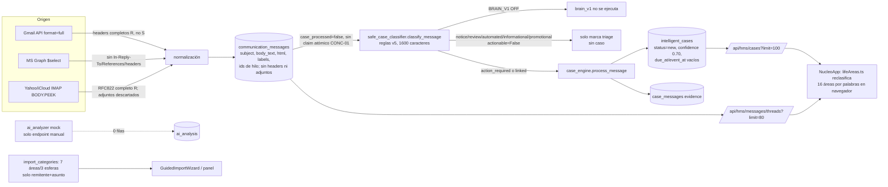

# Auditoría y especificación del motor de casos reales de Donexto

Fecha: 30 oct 2026 (hora de Ciudad de México). Base del código: `origin/main` (los PR #211 y #212 ya están mezclados). Autor: Grok, para auditoría de ASTRA IA.
**Modo:** solo lectura. En producción solo se ejecutaron SELECT. No hubo descargas, acceso al buzón, importación, clasificación, reinicio, despliegue, fusión ni migración. BRAIN_V1 y push siguen apagados. **No se implementó nada.**
Antecedentes: `docs/auditorias/eval01/diagnostico-casos.md` (rama `docs/eval01-diagnostico-casos`, 93d1c75) y CONC-01 (PR borrador #214). Nota: el brief cita "PR #207", pero #207 es el issue CONC-01; la corrección está en el borrador #214.

Convención de evidencia: `archivo:línea` relativo a `backend/app/services/` salvo que se indique otra ruta.

---

## A. Diagnóstico del sistema actual

**Lo que hace realmente en producción hoy**, demostrado con código y datos:

1. **Clasificación 100% determinista por palabras clave.** La ruta activa es `safe_case_classifier.classify_pending_messages` (`safe_case_classifier.py:475`). Con `BRAIN_V1_ENABLED` apagado (`brain_v1/__init__.py:13`) no entra al motor v1 (`safe_case_classifier.py:547`). La función `classify_message` (`:317`) lee solo el asunto, los primeros 1,600 caracteres de `body_text` (o `snippet`), las etiquetas y el remitente (`:323-327`).
2. **La IA no está activa.**
   - `ai_analyzer.py` tiene por defecto `AI_PROVIDER=mock` (`ai_analyzer.py:905-918`, reglas locales). Solo se invoca desde el endpoint manual `api/ai.py:40`; no forma parte de la importación ni de la clasificación.
   - En producción `ai_analysis` tiene **0 filas** (en toda la base) y `communication_messages.ai_processed=true` cuenta **0**.
   - El respaldo LLM de BRAIN_V1 (`brain_v1/llm_fallback.py:40`) exige otra bandera, `BRAIN_V1_LLM_FALLBACK`, y BRAIN_V1 nunca corrió: `brain_signals` no es nulo en **0** mensajes.
   - **Dictamen:** no existe análisis semántico en producción. Lo que la interfaz presenta como "inteligente" es la clasificación determinista.
   - No leí las variables de Railway, para no exponer secretos; la conclusión se apoya en los datos.
3. **Creación de casos:** `case_engine.process_message` (`case_engine.py:733`) solo se llama cuando `actionable=True` (`safe_case_classifier.py:589`). Inserta en `intelligent_cases` con `status="new"` y `confidence=0.70` fijo (`case_engine.py:816-858`) y agrega un vínculo en `case_messages` (`:985-995`). **No extrae fechas límite, importes ni referencias:** `due_at` y `event_at` nunca se llenan en la ruta heredada. Tampoco cierra casos de forma automática.
4. **Vinculación:** `_find_case_for_message` (`case_engine.py:361-454`) busca en este orden: hilo, In-Reply-To/References, `event_key` y, al final, asunto normalizado con evidencia corroborada. No usa el asunto solo, y eso está bien.
5. **Concurrencia (CONC-01):**
   - No hay una reclamación atómica del mensaje: la selección por `case_processed=false` (`safe_case_classifier.py:536`) no bloquea las filas.
   - El orden "insertar el caso → insertar case_messages → marcar procesado" no es transaccional, y una falla intermedia deja casos huérfanos.
   - La corrección está en el borrador #214. Hoy hay 0 huérfanos.
6. **Tres clasificadores independientes, sin una taxonomía común:**
   - La vista previa de importación (`import_categories.py:118,144`) clasifica con remitente y asunto en 7 áreas y 3 esferas.
   - El triage del backend (`safe_case_classifier.py`, `logistica1-triage-v5`) tiene 7 categorías.
   - El dashboard reclasifica en el navegador con palabras clave en 16 áreas (`frontend/lib/nucleo/lifeAreas.ts:9-27,247`).
   - El brief menciona "diez áreas", pero en el código no existe ninguna lista de 10.
7. **Resultado medido (EVAL-01):** 500 mensajes → 1 caso. Ver E.

## B. Matriz de extracción por proveedor

D = disponible en origen · R = recuperado · S = almacenado · A = analizado · U = usado en decisiones.
Rutas: Gmail API (`gmail_full_sync.py:187` `format=full`, `gmail_sync.py:533`); Microsoft Graph (`microsoft_import.py:37-41` `$select`); IMAP genérico (`yahoo_import.py`, que también sirve a iCloud y `gmail_imap`; `:62-87`, fetch `BODY.PEEK[]` en `imap_provider.py:58`, `yahoo_import.py:384`).

| Campo | Gmail API | MS Graph | Yahoo IMAP | iCloud IMAP |
|---|---|---|---|---|
| Message-ID | D R S (`gmail_full_sync.py:295`) | D R S (`internetMessageId`, `microsoft_import.py:506`) | D R S (`yahoo_import.py:677`) | igual que Yahoo |
| ID interno | D R S `external_message_id` | D R S | UID → `external_message_id` | igual |
| Thread-ID | D R S `threadId` (`:196`) U | D R S `conversationId` (`:478`) U | **no existe**; se deriva de In-Reply-To/Message-ID (`yahoo_import.py:463`) U | igual |
| In-Reply-To | D R S (`:302`) U | **D, no R**: se guarda `None` (`microsoft_import.py:511`) | D R S (`:681`) U | igual |
| References | D R S (`:309`) U | **no R**: `[]` (`:512`) | D R S (`:685`) U | igual |
| From (nombre + dirección) | D R S A U | D R S A U | D R S A U | igual |
| To / CC | D R S; A solo para detectar dirección propia | D R S | D R S (`:629-631`) | igual |
| BCC | solo en enviados | D R S | solo en enviados | igual |
| Dominio / organización | derivado, no S | no S | no S | no S |
| Date | D R S → `received_at` | `receivedDateTime` S | Date → `received_at` (`:614-624`), **UTC; la zona original se pierde** | igual |
| internalDate / Received | D (`gmail_sync.py:219`), solo en el respaldo | D, no S | INTERNALDATE no R | igual |
| Fechas mencionadas / vencimiento | D en el texto; no se extraen en la ruta heredada (BRAIN_V1 tiene `dates.py`, apagado) | igual | igual | igual |
| Encabezados completos | D R; **no S** (no hay columna) | no R | D R (RFC822 completo); no S | igual |
| Return-Path / Received / Authentication-Results | D R, no S, no A | no R | D R, no S, no A | igual |
| List-Unsubscribe / List-ID | D R, no S; A solo en la vista previa (`import_preview.py:32,82`) | no R | D R en la vista previa (`yahoo_import.py:447`); no S | igual |
| Subject | D R S A U | D R S A U | D R S A U | igual |
| Texto plano | D R S A U (1,600 caracteres) | D R S A U | D R S A U (`yahoo_imap.py:423`) | igual |
| HTML | D R S (544/550 en EVAL-01); A solo como texto derivado | D R S (`_body_parts` `:338`) | D R S | igual |
| Texto citado / firmas | dentro del cuerpo, sin separar | igual | igual | igual |
| Enlaces / tablas | dentro del HTML; no A | igual | igual | igual |
| Imágenes | no se procesan | no | no | no |
| Adjuntos: existencia | D R S `has_attachments` (51/550) | D R S | D R S (`yahoo_imap.py:432`) | igual |
| Adjuntos: nombre, MIME, tamaño, contenido, texto | D; **se descartan** (`yahoo_imap.py:432-434` `continue`); la tabla `attachments` tiene **0 filas** | no R | se descartan | igual |
| Etiquetas / carpetas | `labelIds` S U | carpeta → `labels` S U | carpeta + proveedor (`:642-643`) S U | igual |
| Categorías Gmail (Promociones, etc.) | D R S **U** (`safe_case_classifier.py:382-388`) | `categories` D, no R | no existe | no existe |
| Prioridad / importancia | no se usa | `importance` D, no R | X-Priority D, no S | igual |
| Estado de lectura | D R S U (+5 puntos, `:430`) | D R S U | `\Seen` R S U (`:644`) | igual |

## C. Matriz de campos almacenados y utilizados

Columnas de `communication_messages`, verificadas en `information_schema`:

| Columna | Almacenada | Analizada por la ruta activa | Usada en decisiones | Evidencia |
|---|---|---|---|---|
| sender | sí | sí | sí (remitente promocional, automatizado o identidad conocida) | `safe_case_classifier.py:229-244` |
| subject | sí | sí | sí | `:325-327` |
| body_text | sí | **solo 1,600 caracteres** | sí | `:327` |
| body_html | sí | no | no | – |
| snippet | sí | solo como respaldo | sí | `:326` |
| labels | sí | sí | sí | `:323,331-388` |
| is_unread | sí | sí | +5 puntos | `:430` |
| direction | sí | sí | sí (saliente) | `:335` |
| recipients / cc / bcc | sí | solo para dirección propia | parcial | `:342` |
| thread_id | sí | sí | vinculación | `case_engine.py:384` |
| internet_message_id, in_reply_to, references_header | sí | sí | vinculación | `case_engine.py:479,536` |
| has_attachments | sí | no | no | – |
| correlation_key, classification_rule_id | sí | no (0 filas con regla en EVAL-01) | no | SQL Q-C2 |
| brain_confidence / brain_signals | sí (columnas) | no (BRAIN_V1 apagado; 0 filas) | no | SQL Q-C2 |
| ai_processed | sí | no (0 en toda la base) | no | SQL Q-C2 |

En `intelligent_cases`, `due_at`, `event_at`, `resolved_at` y `closed_at` existen pero la ruta heredada no los llena. El dashboard sí los lee (`frontend/lib/nucleo/lifeAreas.ts:462`), así que "Próximos vencimientos" queda vacío por diseño.

## D. Diagrama de trazabilidad



## E. Evaluación de los 500 mensajes (job 99b1445c)

Método: SELECT de solo lectura sobre los campos almacenados (dominio del remitente, asunto con dígitos enmascarados, triage y razón). El conjunto de referencia lo construí leyendo asuntos y dominios; las consultas están en el Anexo SQL. **No leí los cuerpos completos ni consulté el buzón original.**

| Métrica | Valor | Nota |
|---|---|---|
| Mensajes evaluados | 500 (`case_processed=true`) | Los 50 pendientes de CONC-01 quedan excluidos |
| Casos reales, confianza A | **8** | obligación o riesgo explícito en el asunto |
| Casos reales, A + M | **19** | M: falta leer el cuerpo o confirmar con el usuario |
| Casos detectados | 1 | `103d0bec…` (BBVA) |
| Casos omitidos (falsos negativos a nivel caso) | 7 (A) / 18 (A+M) | |
| Falsos positivos | 0 | El único caso es legítimo |
| Duplicados | 0 | 1 caso, 1 case_message |
| Casos cerrados incorrectamente | 0 | No existe lógica de cierre: nada se cierra |
| Casos creados pero no visibles | 0 | Solo hay 1 caso en el workspace |
| Información perdida | adjuntos 51/550 (contenido descartado); encabezados no guardados; zona horaria original perdida; 544 HTML guardados pero no analizados | |
| Hilos | 545 hilos para 550 mensajes | Yahoo casi no agrupa (ver H-08) |

Distribución obtenida: notice 268, review 133, automated 69, informational 19, promotional 10, action_required 1.
**Limitación:** precision y recall a nivel mensaje no son calculables sin etiquetas oro humanas (`docs/auditorias/eval01/protocolo.md`). Con la referencia A, el recall a nivel caso es 1/8 = 0.125 y la precision 1/1. **Estos valores son indicativos, no definitivos.**

## F. Ejemplos documentados de casos reales omitidos

Solo se muestran IDs, dominio y categoría genérica, sin contenido sensible.

| # | id (prefijo) | dominio | acontecimiento | msgs | obtenido | regla responsable |
|---|---|---|---|---|---|---|
| F1 | c48c5ec6 | bazdigital.com | cargo recurrente rechazado | ~60 | notice | `safe_case_classifier.py:375-381` (aviso de seguridad, no accionable) + sin agregación |
| F2 | cbd449cd | cfe.mx | cobro de servicio de luz | 4 (+2 notas propias) | review | `:437-438` (review por omisión); "aviso de cobro" no está en `PAYMENT_ACTION_TERMS` (`:179`) |
| F3 | 85ef9461 | cleverbridge.com | renovación con pago no autorizado | 2 | automated | `:390` antes que el contenido |
| F4 | fbe0b47a | accountprotection.microsoft.com | acción requerida de seguridad | 1 | notice | `:386-387` (`NOTICE_TERMS` contiene "acción requerida", pero `actionable=False`) |
| F5 | d9d641aa | envio.santander.com.mx | tarjeta no entregada | 1 | notice | `:309-314` (banco conocido, no accionable) |
| F6 | 9d3c640e | dif.gob.mx | hilo laboral humano de prestaciones | 11 | notice/review | `:437` (hilo humano sin una frase de la lista) |
| F7 | 55ba15ce | dif.gob.mx | obligación de declaración patrimonial | 1 | review | vocabulario ausente |
| F8 | 0375affd | bbva.mx | crédito de auto: mantener al corriente | 14 | notice | `:309-314` + sin agregación |

Lista completa (19) en `docs/auditorias/eval01/diagnostico-casos.md` §4.

## G. Análisis de falsos positivos y falsos negativos

- **Falsos positivos:** 0 casos. Riesgo latente: ~10 promociones bancarias (BBVA "oferta especial", "liquidar con descuento") quedan como `notice` porque el marketing solo se detecta por la parte local del remitente (`safe_case_classifier.py:277,287`). **Si se vuelve accionable `notice` sin un filtro de contenido, se convertirán en falsos positivos.** Las campañas de remify, teatrix y sanborns quedaron en `review` y no en `promotional` (`:437`).
- **Falsos negativos, por causa:**
  1. `notice` nunca crea caso (268 mensajes).
  2. Vocabulario conversacional, no transaccional (~90).
  3. `automated` se evalúa antes que el contenido (69).
  4. `review` es la categoría por omisión y nunca crea caso (133).
  5. No hay agregación de repeticiones (~80).
  6. Términos de seguridad que coinciden con pies de página (~60).

## H. Defectos identificados (archivo:función:línea)

| ID | Sev. | Ubicación | Defecto |
|---|---|---|---|
| H-01 | Crítica | `safe_case_classifier.py:_classify_known_vertical:309-314`, `classify_message:375-381,386-387` | Ningún `notice` es accionable, aunque reconozca un pago rechazado o una acción requerida |
| H-02 | Alta | `safe_case_classifier.py:152-193` (`DIRECT_ACTION_TERMS`, `PAYMENT_ACTION_TERMS`) | Solo frases conversacionales; faltan obligaciones transaccionales en español de México |
| H-03 | Alta | `safe_case_classifier.py:classify_message:390` | `_sender_is_automated` descarta antes de leer el contenido |
| H-04 | Alta | `safe_case_classifier.py:_classify_by_content:437` | `_sender_email(sender)` casi siempre es verdadero, así que `review` termina siendo el destino por omisión |
| H-05 | Alta | `safe_case_classifier.py:327` | Solo se analizan 1,600 caracteres del cuerpo; el HTML y los adjuntos se ignoran |
| H-06 | Alta | `case_engine.py:process_message:816-858` | No extrae `due_at`, `event_at`, importe ni referencia; confianza fija de 0.70; sin cierre ni reapertura |
| H-07 | Alta | `safe_case_classifier.py:475-542`, `case_engine.py:985` | CONC-01: sin reclamación atómica ni transacción (corrección en borrador #214) |
| H-08 | Media | `yahoo_import.py:_external_thread_id:463-471` | Usa In-Reply-To antes que References[0] (raíz), lo que divide hilos profundos (545 hilos para 550 mensajes) |
| H-09 | Media | `microsoft_import.py:37-41,511-512` | No pide `internetMessageHeaders`; In-Reply-To y References quedan vacíos |
| H-10 | Media | `yahoo_imap.py:extract_rfc822_bodies:432-434` | Los adjuntos se descartan; la tabla `attachments` sin uso (0 filas) |
| H-11 | Media | (esquema) | Los encabezados (List-Unsubscribe, Authentication-Results) se recuperan pero no se guardan, así que BRAIN_V1 (`brain_v1/analyzer.py:346`) no puede usarlos al clasificar |
| H-12 | Media | `taxonomy.py:204` + `safe_case_classifier.py:375` | SECURITY_NOTICE_TERMS se aplica al cuerpo completo y coincide con pies de página |
| H-13 | Media | `safe_case_classifier.py:569-582` vs `case_engine.py:790-803` | El clasificador busca el caso sin `event_key` y el motor con `event_key`: dos criterios de vinculación distintos |
| H-14 | Media | `import_categories.py`, `safe_case_classifier.py`, `frontend/lib/nucleo/lifeAreas.ts:247` | Tres taxonomías independientes (7 / 7 / 16 áreas); el dashboard reclasifica en el navegador |
| H-15 | Baja | `ai_analyzer.py:905-918`, `api/ai.py:40` | Análisis "IA" simulado (mock), fuera del flujo; 0 filas |
| H-16 | Baja | `yahoo_import.py:614-624` | Se pierde la zona horaria original y no se usa INTERNALDATE |

## I. Arquitectura propuesta

**Justificación de cambio (prueba de insuficiencia):** la arquitectura actual no puede, por construcción:
- (a) crear casos de avisos (H-01);
- (b) registrar fechas e importes (H-06);
- (c) agrupar alertas repetidas;
- (d) cerrar casos;
- (e) usar adjuntos y encabezados (H-10, H-11).

Esto no se corrige solo ampliando vocabulario: la falla está en el modelo "un mensaje → sí o no crear caso".

**No propongo una reescritura completa.** El repositorio ya tiene `brain_v1/` (unas 2,900 líneas: analyzer, dates, documents, protected, phishing_v2, taxonomy_v2, llm_fallback, engine con `find_case_v1`, duplicados y estados `scheduled/no_action/needs_review`). Cubre buena parte de las cuatro capas, pero **nunca se ha medido con datos reales** (0 filas). Propuesta:

| Capa | Hoy | Propuesta |
|---|---|---|
| 1. EXTRACTOR | adaptadores por proveedor | Guardar encabezados relevantes, metadatos de adjuntos y texto de PDF; corregir H-08 y H-09 |
| 2. ANALIZADOR SEMÁNTICO | reglas v5 / brain_v1 analyzer apagado | brain_v1 analyzer más un LLM opcional, solo para interpretar y siempre con evidencia citada |
| 3. MOTOR DE CASOS | case_engine (crear o vincular) | brain_v1 engine extendido a CREATE/UPDATE/REVIEW/INFO más cierre y reapertura, con una sola taxonomía en el backend |
| 4. VERIFICADOR | ausente (solo `_scope_guard`) | Reglas deterministas: importes, fechas, referencias, alcance del usuario, deduplicación, idempotencia (#214) |

La IA interpreta el lenguaje; las reglas deterministas validan los datos estructurados y la integridad. Antes de encender nada: **evaluación offline de brain_v1 contra el conjunto oro** (ya existe `backend/scripts/eval_brain.py`), en una copia aislada y con autorización.

## J. Lógica funcional completa del motor de casos

1. **Entrada:** mensaje reclamado de forma atómica (patrón #214), con su hilo y sus adjuntos.
2. **Filtro de masivos:** List-Unsubscribe o List-ID **y** ninguna señal de obligación → `INFORMATION_ONLY` (categoría I).
3. **Extracción en 7 dimensiones** (identidad, hecho, acción, obligación, tiempo, evidencia, estado) en un objeto `event_extraction` (K). Cada campo lleva `evidence_ref` (mensaje o adjunto, desplazamiento) o `unknown`; **nunca se inventan datos**.
4. **Tipificación** según la taxonomía A–J del brief (una sola taxonomía en el backend; el dashboard solo la muestra).
5. **Clave de identidad del acontecimiento:** (workspace, entidad u organización, tipo, referencia fuerte: factura, pedido, transacción, folio). Sin referencia: (entidad, tipo, importe y moneda, ventana de N días). Nunca solo `normalized_subject`.
6. **Decisión:**
   - Coincide un caso abierto o reciente por hilo, References o clave → `UPDATE_CASE` (agrega evidencia y transiciona el estado).
   - Sin coincidencia y con hecho real (obligación, compromiso, cita, alerta, compra) con confianza ≥ umbral → `CREATE_CASE`, aunque ya esté resuelto (por ejemplo, un pago confirmado se crea como `closed`).
   - Relevante pero ambiguo, o con datos contradictorios → `REVIEW` con la razón explícita.
   - En cualquier otro caso → `INFORMATION_ONLY`.
7. **Estados:** `new → open → waiting_external/scheduled → resolved → closed`, con `reopened` ante nueva evidencia.
   - Un recibo de pago aplicado cierra el caso de adeudo solo si coinciden la referencia o el importe (P0.2 sigue vigente).
   - Una contradicción (otro importe para la misma referencia) pasa a `REVIEW`.
8. **Agregación:** N avisos iguales en la ventana → 1 caso con `occurrence_count` y una línea en el historial por mensaje.
9. **Historial:** `case_events` para cada transición, con `message_id` de evidencia.
10. **Seguridad:** las alertas de credenciales o accesos generan un caso de prioridad alta, salvo que estén correlacionadas con una acción propia conocida (por ejemplo, la conexión de Donexto). Las alertas repetidas se agregan.
11. **Idempotencia:** UNIQUE `(case_id, message_id)` y `(workspace_id, event_identity_key)` en casos abiertos, con reclamación por `UPDATE … WHERE case_processed=false RETURNING`.

## K. Modelo de datos propuesto

Ver `propuesta-modelo.sql` (**solo propuesta, no aplicada**). Contenido:
- `message_headers`: encabezados seleccionados.
- Uso real de `attachments`, más `attachment_text`.
- `event_extractions`: campos con su evidencia.
- En `intelligent_cases`: `event_identity_key`, `amount`, `currency`, `occurrence_count`, `taxonomy_area`.
- Restricciones UNIQUE.

## L. Plan de correcciones por prioridad

| P | Corrección | Defectos | Requiere |
|---|---|---|---|
| P0 | Fusionar CONC-01 (#214) tras su auditoría | H-07 | ASTRA |
| P0 | Construir el conjunto oro de EVAL-01 (etiquetas humanas de los 500) | E | Héctor |
| P1 | Evaluación offline de brain_v1 frente a v5 sobre el conjunto oro (copia aislada) | H-01…H-06 | ASTRA |
| P1 | Si brain_v1 supera a v5: separar notice en accionable e informativo, agregar vocabulario transaccional, evaluar el contenido antes que el remitente automatizado, restringir review | H-01–H-04, H-12 | |
| P2 | Extracción de `due_at`, `event_at`, importe y referencia con evidencia; estados y cierre | H-06 | migración K |
| P2 | Agregación de repeticiones y clave de identidad del acontecimiento | E | migración K |
| P3 | Extractor: encabezados, adjuntos, Graph `internetMessageHeaders`, raíz de hilo en IMAP, INTERNALDATE | H-08–H-11, H-16 | migración K |
| P3 | Una sola taxonomía en el backend; el dashboard deja de reclasificar | H-13, H-14 | diseño en Figma (pendiente) |
| P4 | Retirar `ai_analyzer` mock o integrarlo honestamente como "reglas" | H-15 | |

## M. Pruebas y criterios de aceptación

Métricas (definición):
- **Precision** = casos correctos / casos creados.
- **Recall** = casos oro detectados / casos oro (a nivel acontecimiento).
- **Duplicación** = casos sobrantes por acontecimiento / casos.
- **Integridad de extracción** = campos correctos / campos oro.
- **Trazabilidad** = campos con `evidence_ref` válido / campos extraídos.
- **Exactitud de estados** = estado correcto / casos.
- **Consistencia backend↔dashboard** = casos y áreas del API iguales a los que muestra la UI.

Criterios **verificables** (umbrales **provisionales**, tomados de `protocolo.md`; se fijarán con la distribución real del conjunto oro):

1. Precision ≥ 0.85 y recall ≥ 0.80 a nivel acontecimiento sobre el conjunto oro de EVAL-01.
2. 0 asociaciones entre usuarios distintos; duplicación ≤ 5%.
3. 100% de los campos extraídos con `evidence_ref` resoluble; 0 campos inventados (verificación manual de una muestra).
4. Pruebas de concurrencia de CONC-01 en verde (2 workers, reintento, fallo intermedio): 0 casos duplicados, 0 huérfanos.
5. Pruebas unitarias por cada ejemplo F1–F8 (fixtures sintéticos sin datos reales) con la decisión esperada.
6. Recibo pagado → cierra solo si coinciden la referencia o el importe; promoción bancaria → INFORMATION_ONLY.
7. Dashboard: el área, la fecha y el estado de cada caso vienen del backend; prueba e2e de que "Próximos vencimientos" muestra `due_at`.
8. **Descargar o clasificar mensajes no cuenta como éxito:** solo cuentan las métricas 1–3.

## N. Dictamen técnico

**NO VERIFICADO: Donexto no identifica casos reales hoy.**
- La ruta activa es un clasificador determinista de palabras clave cuyo diseño impide crear casos de avisos (H-01). En EVAL-01, el recall indicativo es 1/8.
- No hay análisis semántico activo: la IA es simulada (mock) y no forma parte del flujo; BRAIN_V1 está apagado y nunca se ha ejecutado.
- No se extraen fechas, importes, referencias, adjuntos ni encabezados al flujo de decisión.
- No hay casos ocultos ni falsos positivos; el problema es de omisión.
- La arquitectura de cuatro capas se puede alcanzar con brain_v1 más el extractor y el verificador, sin una reescritura total, **siempre que la evaluación offline lo demuestre**.
- Siguiente fase: requiere autorización expresa de Héctor.

### Limitaciones

- La referencia esperada se construyó con asunto, dominio y razón; no se leyeron los cuerpos completos. Los casos M requieren confirmación.
- No hay etiquetas oro humanas, así que precision y recall no son definitivos.
- Los 50 mensajes pendientes quedan excluidos.
- No se leyeron las variables de Railway (para no exponer secretos); la inactividad de la IA se demuestra con 0 filas en producción.
- iCloud y Microsoft se auditaron solo por código: no hay datos de esos proveedores en producción (proveedores presentes: `gmail_imap`, `yahoo`).
- Las líneas citadas corresponden a `origin/main` en la fecha del informe.

### Anexo SQL (solo SELECT)

```sql
-- Q-C1: distribución de triage (ver diagnostico-casos.md Q1)
-- Q-C2: cobertura de campos e IA
select (select count(*) from communication_messages where ai_processed) ai_proc,
       (select count(*) from ai_analysis) ai_rows,
       (select count(*) from communication_messages where brain_signals is not null) brain_rows,
       (select count(*) from attachments) att_rows;
select count(*) filter (where has_attachments) att, count(*) filter (where in_reply_to is not null) irt,
       count(*) filter (where internet_message_id is not null) mid,
       count(*) filter (where body_html<>'') html, count(distinct thread_id) threads
from communication_messages where account_id='d493c747-c49c-4b8c-882a-5238a3079fba';
-- Q-C3: casos, eventos y huérfanos
select c.id, c.status, (select count(*) from case_messages cm where cm.case_id=c.id)
from intelligent_cases c where c.workspace_id='15c1e9b8-4f53-4492-84f3-21771ba15798';
select count(*) from intelligent_cases c where not exists (select 1 from case_messages cm where cm.case_id=c.id);
-- Q-C4: esquema
select table_name, column_name from information_schema.columns
where table_schema='public' and table_name in ('communication_messages','intelligent_cases','attachments');
```
