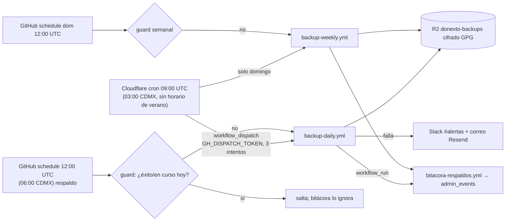

# donexto-backup-cron (EN ESPERA — crons = [])

Dispara los respaldos de GitHub Actions desde el cron de Cloudflare (Workers gratis: 5 crons por cuenta, 100k req/día; este usa 1 invocación/día).

- El Worker no hace pg_dump/gpg/R2 (necesita runner con binarios y >30 s CPU): solo dispara.
- Diario y semanal son independientes (grupos de concurrencia distintos; la falla de uno no frena al otro).
- Activar (con aprobación): `crons = ["0 9 * * *"]` y `wrangler deploy`. Secreto: `GH_DISPATCH_TOKEN` (nombre; valor solo en Cloudflare).
- Pruebas: `node --test index.test.mjs` y `python3 -m unittest scripts/tests/test_backup_guard.py`.

## Cierre de auditoría (ASTRA, 22 oct 2026)

**Token mínimo.** Hoy `GH_DISPATCH_TOKEN` = `GH_BOT_TOKEN` reutilizado (PAT con permisos amplios del bot). Recomendado: PAT *fine-grained* nuevo, solo repositorio `com22fb-bot/hms-ai-assistant`, permiso **Actions: Read and write** (+ Metadata: read obligatorio), vencimiento ≤ 1 año. En repo público, `Actions: read` no basta para dispatch. No se ha creado (requiere aprobación).

**Idempotencia.**
- Guard (`scripts/backup_guard.py`): lista paginada (`gh api --paginate`, `created>=día UTC`); solo corridas *anteriores* (id menor) bloquean; bloquean si están en vuelo (queued/waiting/pending/requested/in_progress) o si terminaron success con el job `backup` realmente ejecutado. Aplica a `schedule` y a `workflow_dispatch` con `origen=cf-cron`; el dispatch manual siempre corre.
- Concurrencia por workflow con `cancel-in-progress: false`: la segunda corrida espera y su guard se evalúa al terminar la primera (re-chequeo).
- Falla abierta: si el guard o la API fallan, se respalda (doble respaldo inocuo; faltante no).
- Worker: antes de reintentar consulta si GitHub ya creó una corrida `workflow_dispatch` en el último minuto (respuesta perdida tras aceptar) y, en todo caso, el guard deduplica `cf-cron`.

**Alertas.**
| Falla | Aviso |
|---|---|
| Respaldo falla en el runner | Slack #alertas + correo Resend (pasos `if: failure()`) + bitácora |
| Worker no logra disparar | Error visible en Cloudflare (observability); red de seguridad: schedule de GitHub 12:00 UTC |
| GitHub caído | No hay respaldo ni alerta desde GitHub |
| GitHub + Slack + Resend caídos | **Hueco hoy.** Propuesta (no implementada, requiere aprobación): segundo cron del Worker 15:00 UTC que lea el último objeto `db/` del bucket R2 (binding gratuito) y, si tiene > 26 h, avise por Cloudflare Email Routing (`send_email`, gratis) a la dirección verificada de Héctor. Independiente de GitHub, Slack y Resend. |

**Estado.** El cron real NO se ha probado (la prueba de 00:25 UTC no disparó). Worker desplegado con `schedules: []`.

## GH_DISPATCH_TOKEN (dedicado, mínimo)
Fine-grained PAT de la cuenta dueña del repo: *Repository access* = solo `com22fb-bot/hms-ai-assistant`;
*Permissions* = **Actions: Read and write** (Metadata: Read se agrega solo). Nada más. Vigencia ≤ 1 año.
Guardarlo en Doppler `donexto/prd` como `GH_DISPATCH_TOKEN`; desde ahí se carga con
`wrangler secret put GH_DISPATCH_TOKEN` y se activa `crons = ["0 9 * * *"]`.
