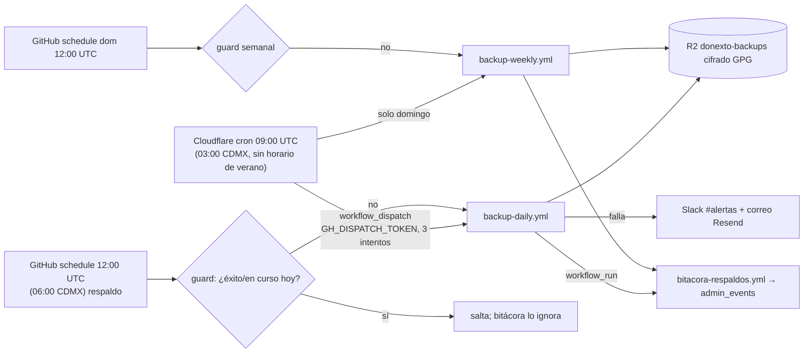

# donexto-backup-cron (EN ESPERA — crons = [])

Dispara los respaldos de GitHub Actions desde el cron de Cloudflare (Workers gratis: 5 crons por cuenta, 100k req/día; este usa 1 invocación/día).

- El Worker no hace pg_dump/gpg/R2 (necesita runner con binarios y >30 s CPU): solo dispara.
- Diario y semanal son independientes (grupos de concurrencia distintos; la falla de uno no frena al otro).
- Activar (con aprobación): `crons = ["0 9 * * *"]` y `wrangler deploy`. Secreto: `GH_DISPATCH_TOKEN` (nombre; valor solo en Cloudflare).
- Pruebas: `node --test index.test.mjs` y `python3 -m unittest scripts/tests/test_backup_guard.py`.
